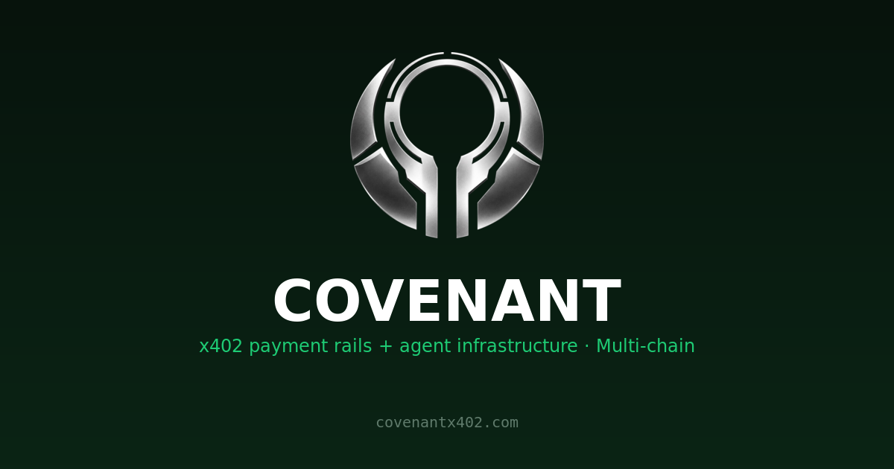

<p align="center">
  
</p>

<h1 align="center">COVENANT</h1>
<p align="center"><strong>Multi-chain x402 payment rails + agent infrastructure</strong></p>

<p align="center">
  <a href="https://github.com/covenantx402/covenant/actions/workflows/ci.yml"></a>
  <a href="https://www.npmjs.com/package/@covenantx402/x402-kit"></a>
  <a href="LICENSE"></a>
  
  
  
</p>

<p align="center"></p>

> Paid agent endpoints in USDC/USDG over x402, with instant on-chain settlement and credentials that never touch a prompt.

COVENANT turns any endpoint into a paid stablecoin route, settles through **x402 — v1 and v2 simultaneously** — across **four chains (Robinhood 4663, Ethereum, Base, Arbitrum)**, and brokers agent credentials through a live vault so models can use secrets without seeing them. Open source, MIT-licensed.

Five pillars, one gateway:

| Layer | What it does | Where |
|---|---|---|
| **Payments** | Any endpoint → paid x402 route. 402 → signed intent → on-chain settlement. Dual-protocol: emits x402 v1 (JSON body) *and* v2 (`Payment-Required` header + `extensions.bazaar` discovery) on every paid response. | `kit/` + `gateway/` |
| **Multi-chain** | One agent, one key, four settlement rails — pay on whichever chain has your liquidity. `GET /chains` returns live readiness (RPC up, gas funded) per chain before you commit to one. | `gateway/chains.js`, `gateway/facilitator.js` |
| **Vault** | Agent credential broker. Secrets referenced as `{{name}}`, AES-256-GCM at rest, scrubbed from every readback. | `gateway/agent-vault.js` |
| **Identity** | Every agent gets a server-generated wallet + a `cvn_...` API key on first use. | `gateway/wallets.js`, `gateway/keys.js` |
| **Reputation** | Every settled payment feeds an explainable 0–100 score, anchored to real tx hashes — not a black box. | `gateway/reputation.js` |

## Why this isn't "just a 402 demo"

- **Four chains, one replay-guard, correctly scoped.** Robinhood Chain (USDG), Ethereum, Base, and Arbitrum (Circle-native USDC) — each chain's own RPC, settlement wallet instance, and EIP-712 domain (`chainId` is part of the domain, so a signature for chain A cannot replay on chain B). The nonce table's primary key is `(chain_id, nonce)`, not just `nonce` — a SQLite schema migration (not a greenfield assumption) that keeps old single-chain history intact while making cross-chain nonce collision structurally impossible.
- **BNB Chain was evaluated and explicitly rejected, not silently skipped.** Its "USDC" is Binance-Peg (bridged, not Circle-issued), 18 decimals instead of 6, no EIP-3009/`DOMAIN_SEPARATOR`. Mixing an 18-decimal asset into 6-decimals-everywhere code is exactly the silent-wrong-amount bug class that shouldn't ship — see the comment in `gateway/chains.js`.
- **Every asset address was verified on-chain before being added**, not copied from a block explorer listing — `eth_getCode` + `symbol()`/`decimals()`/`name()`/`DOMAIN_SEPARATOR()` via `eth_call` against a public RPC.
- **Machine-readable discovery that's actually complete.** `GET /openapi.json` returns a full OpenAPI 3.1 document — every paid route carries `x-payment-info` with *both* the per-call and session protocols, so an agent scanner (e.g. [x402scan](https://www.x402scan.com)) discovers the cheaper session option without a human reading the README first.
- **Dual x402 transport, same route.** The ecosystem moved from v1 (JSON-body challenge) to v2 (`Payment-Required` header + `extensions.bazaar`) in Dec 2025. COVENANT's `x402-v2.js` adapter encodes a spec-compliant v2 header with the official `@x402/core` codec on top of the same route data — old clients and new clients both get a valid 402, no flag-flipping.
- **Settlement is the honest `approve+transferFrom` pattern, not a claimed EIP-3009.** None of the four supported chains' deployments implement `transferWithAuthorization` as COVENANT uses them — verified against on-chain bytecode, documented in the code rather than assumed. See [How settlement works](#how-settlement-works).
- **Sessions aren't a toy feature.** Settle once (0.01 USDG → 100 calls / 1h), then `POST /session/redeem` per call with **no wallet interaction, no signature, no on-chain tx** — a 100x cost reduction for agents that hammer an API, and it's advertised in the OpenAPI doc's `x-payment-info.protocols[1]`, not hidden behind a support thread.
- **Reputation is explainable, not vibes.** `score(address)` = settled-count (log scale, 40pt) + cumulative volume (25pt) + longevity (15pt) + recency (20pt) — every point traceable to a real settlement tx hash via `GET /reputation/:address`.
- **Signed webhooks, not an open POST.** The kit's `settlementWebhook` carries an HMAC-SHA256 `X-Covenant-Signature` header when `settlementWebhookSecret` is set, with constant-time verification and 3-attempt exponential-backoff delivery — a receiver can reject spoofed settlement callbacks instead of trusting whoever finds the URL.
- **Prometheus metrics, not just a JSON dashboard.** `GET /metrics` exposes the same live counters as `/x402/stats` in standard text-exposition format — drop the gateway into existing Grafana/Alertmanager stacks without scraping JSON.

## Repository layout

```
gateway/   Zero-dependency HTTP gateway: RPC proxy, x402 v1+v2, vault, facilitator (settlement), reputation
kit/       TypeScript middleware (@covenantx402/x402-kit) — Express paywall + usage analytics
examples/  Runnable examples: paywalled API, agent client that pays
skill/     Agent skill file (SKILL.md) — teach any agent (Claude/Cursor/Hermes) to use COVENANT
Dockerfile, docker-compose.yml   Multi-stage build + one-command run (see Quick start below)
```

## Quick start (gateway)

```bash
cd gateway
npm install            # pulls ethers, better-sqlite3, @x402/core
cp .env.example .env   # set RPC upstream + settlement key
node server.js         # listens on 127.0.0.1:8792
```

Then explore the machine-readable contract: `curl http://127.0.0.1:8792/openapi.json`

### Quick start (Docker)

```bash
cp gateway/.env.example .env     # fill in at least COVENANT_RPC_UPSTREAM
docker compose up --build
curl http://127.0.0.1:8792/x402/health
```

Data (vault entries, wallets, keys, settlement/nonce history) persists in a
named volume (`covenant-data`) across restarts and rebuilds. The container
binds `0.0.0.0` internally (`COVENANT_HOST=0.0.0.0`, set in `docker-compose.yml`)
so the `-p`/`ports:` mapping actually reaches it — the default bare-metal
bind is `127.0.0.1`, which only works when something else (nginx, a
Cloudflare tunnel) is on the same host.

### Environment

| Variable | Required | Purpose |
|---|---|---|
| `COVENANT_RPC_UPSTREAM` | yes | JSON-RPC URL for Robinhood Chain (e.g. `https://robinhood-rpc.publicnode.com`). Comma-separate for automatic failover (`ethers.FallbackProvider`, quorum 1) on the settlement path — recommended in production. |
| `COVENANT_RPC_ETHEREUM` / `COVENANT_RPC_BASE` / `COVENANT_RPC_ARBITRUM` | for those chains | Same comma-separated-failover RPC config, one per additional chain. A chain with no RPC configured just reports `configured: false` on `GET /chains` — the other chains keep working. |
| `COVENANT_PORT` | no | Listen port (default `8792`) |
| `COVENANT_HOST` | no | Bind address (default `127.0.0.1`). Set to `0.0.0.0` when running in a container or anything else that needs the port reachable from outside localhost. |
| `COVENANT_SETTLE_KEY` | for settlement | Private key of the facilitator's settlement wallet (the spender agents approve) — same key, reused across all four chains (one wallet, four networks). |
| `COVENANT_X402_PAYTO` | no | Default recipient address for paid routes |
| `COVENANT_VAULT_KEY` | recommended | Pepper for vault encryption at rest. Derived from the RPC URL if unset — set your own in production |
| `COVENANT_VAULT_STORE` / `COVENANT_KEYS_STORE` / `COVENANT_WALLETS_STORE` / `COVENANT_SETTLE_STORE` | no | Storage paths (default under `data/`) |
| `COVENANT_TRUSTED_PROXIES` | no | Comma-separated reverse-proxy IPs trusted to set `X-Forwarded-For` for per-IP rate limiting. Leave empty when reached directly. |

## Multi-chain settlement

COVENANT settles on four chains from one gateway, one agent key, one settlement wallet:

| Chain | Chain ID | Asset | Env var |
|---|---|---|---|
| Robinhood Chain | `4663` | USDG (default/legacy) | `COVENANT_RPC_UPSTREAM` |
| Ethereum | `1` | USDC (Circle) | `COVENANT_RPC_ETHEREUM` |
| Base | `8453` | USDC (Circle) | `COVENANT_RPC_BASE` |
| Arbitrum One | `42161` | USDC (Circle) | `COVENANT_RPC_ARBITRUM` |

```bash
curl https://gateway.covenantx402.com/chains
```
Returns every chain's id, asset address, decimals, and **live readiness** (RPC reachable, settlement wallet funded with native gas) — so an agent can pick a working rail before committing to a payment flow instead of discovering a dead RPC mid-settlement.

Pass `?chain=<id>` on any `GET /x402/api/:slug` call (or `chainId` in the signed intent / settle body) to target a non-default chain. Omit it everywhere and behavior is unchanged from the single-chain era — Robinhood 4663 stays the default. Every chain gets its own EIP-712 domain (`chainId` is part of the signed domain), its own memoized RPC provider + settlement wallet instance, and its own nonce/settlement rows keyed by `(chain_id, ...)` — a signature valid on one chain cannot replay on another.

## How settlement works

None of the four supported chains' stablecoin deployments implement EIP-3009 `transferWithAuthorization` the way COVENANT would need — verified against on-chain bytecode, not assumed. COVENANT settles with **approve + transferFrom** on every chain:

1. Gateway returns `402` describing price, asset, recipient, and the facilitator's spender address for the requested chain (v1 JSON body *and* v2 `Payment-Required` header, both on the same response).
2. Agent approves the spender once on that chain (`token.approve(spender, amount)`), then signs an **EIP-712 `PaymentIntent`**:
   ```
   PaymentIntent { from, to, value, validAfter, validBefore, nonce, resource }
   ```
   Domain: `name "COVENANT"`, `version "1"`, `chainId <target chain>`, `verifyingContract` = that chain's stablecoin address.
3. Agent POSTs `{ intent, signature, chainId }` to `POST /facilitator/settle`.
4. Facilitator verifies signature + balance + allowance + authorization window + nonce replay **on that chain**, executes `transferFrom`, returns the tx hash.

Every settlement is replay-guarded by a persisted `(chain_id, nonce)` pair and auditable by tx hash. Set `resource: "session"` instead to open a 100-call / 1h prepaid session in the same settle call — see [`/x402/premium`'s `x-payment-info.protocols[1]`](#why-this-isnt-just-a-402-demo).

## Who pays gas, and the per-chain price floor

Buyers never submit an on-chain transaction or hold a gas token — they only
*sign* an off-chain EIP-712 authorization (free). The **facilitator**
(COVENANT's settlement wallet) submits the on-chain `transferFrom` and pays
that gas. This is the same split every x402 facilitator uses (Coinbase CDP,
PayAI, Dexter, etc.) — it's what "gasless payment" means in this protocol,
not something COVENANT does differently.

What differs between facilitators is how (or whether) they recover that gas
cost. Coinbase CDP charges the seller a flat `$0.001` per on-chain
settlement after a free tier; PayAI marks gas up ~30%; Dexter, like
COVENANT's core routes, charges nothing extra. Because the full signed
`payTo` amount already lands on COVENANT's own wallet for its own routes
(no separate processor fee line), a price set below what gas actually
costs on a given chain is a straightforward loss on every call — so
`POST /facilitator/settle` enforces a **per-chain minimum price** and
rejects anything under it before touching the chain at all:

| Chain | Measured settlement gas cost (2026-10-16 spot check) | Enforced floor |
|---|---|---|
| Robinhood (4663) | negligible (no external USD market for native gas) | none ($0) |
| Base | ~$0.001 | $0.01 |
| Arbitrum One | ~$0.0035 | $0.02 |
| Ethereum | ~$0.028 | $0.05 |

The floor is a static guard (not a live gas-price oracle) sized with
headroom over the spot measurement, so it won't false-positive on normal
gas fluctuation — see `chains.js`'s `minSettlePriceUsd` per chain if you
fork this and need to retune it for your own gas-price environment. A
rejected settlement returns a clear `errorReason` naming the floor and
pointing at `GET /chains` for a cheaper rail; it never silently takes a
loss-making payment. The `/x402/premium` playground's sample price is
`max($0.01, that chain's floor)` for the same reason — it won't hand out a
challenge it can't actually settle.

Third-party marketplace listings (`/x402/marketplace/*`, not COVENANT's own
routes) are the other place COVENANT keeps a cut: `COVENANT_MARKETPLACE_FEE_BPS`
(default 500 = 5%) of each sale, split server-side after delivery.

## Variable pricing: the `upto` scheme

Every route above is flat-rate (x402's `exact` scheme: sign a fixed price,
pull exactly that). `GET /x402/upto/echo` is the one route that genuinely
needs variable pricing, and demonstrates x402's `upto` scheme: the buyer
signs a **ceiling** once; the facilitator settles **up to** that ceiling —
whatever the real per-request cost turns out to be, never more.

**Honest framing:** this demo's real cost (price per word of `?text=`) is
actually knowable *before* settling, from the query string — it doesn't
strictly need "pull less than I expected" semantics the way a metered LLM
call (true cost only known *after* the tokens are generated) or compute-time
billing would. It proves the exact mechanism `upto` needs though: the
challenge advertises a worst-case ceiling (0.0001 USDG/word × 500-word cap =
0.05 USDG), the buyer signs that ceiling once via the same EIP-712
`PaymentIntent` as every other route, and `POST /facilitator/settle` pulls
only the real per-word cost (computed server-side from the text bound into
the signed resource URL — never from a client-supplied amount, and clamped
up to the chain's settlement-cost floor so a short text's literal price
can't fall below what gas costs). A metered resource would compute that real
cost *after* doing the work instead of from a query string, but the
`facilitator.settle(intent, signature, splits, chainId, actualValue)` call
shape — the fifth argument, `null` for every other route's "exact" behavior
— is identical either way. `verify()` still checks the buyer actually
holds/approves the full signed **ceiling**, not just the real charge, by
design — "upto" authorizes the worst case once, not what any single
settlement happens to pull.

```bash
curl https://gateway.covenantx402.com/x402/upto/echo?text=hello+world
# 402 { accepts: [{ scheme: "upto", maxAmountRequired: "50000", ... }] } — the ceiling, not the real charge
```

## Batch settlement: verify N requests for free, settle once

The x402 spec's `batch-settlement` scheme describes a genuine bidirectional
payment channel with an on-chain escrow deposit and a non-cooperative
withdraw with a dispute timer (CDP's spec calls this `withdrawDelay`,
900-2,592,000 seconds). **COVENANT doesn't have that smart contract
deployed.** `/x402/batch/*` implements a simpler "running tab" that gets the
same economic benefit — verify many requests for free, pay gas once instead
of once per request — using nothing but the approve+transferFrom pattern
every other route here already uses:

1. `POST /x402/batch/open` — buyer approves the facilitator spender (same
   `approve()` as every other route), then opens a channel: `{ channelId,
   payer, payTo, validBefore, domain, types }` for signing vouchers against.
2. Each request, the buyer signs a **voucher**: not a per-request amount,
   but the channel's new **cumulative total** ("I now owe up to X total").
   `POST /x402/batch/voucher` verifies it — pure EIP-712 signature recovery
   plus a monotonic-increase check against the channel's current
   high-water mark. **No RPC call, no gas — genuinely free**, exactly like
   the spec's documented behavior.
3. Whenever the facilitator chooses (channel close, a threshold, a cron),
   `POST /x402/batch/claim` executes **one** `transferFrom` for the
   **net-new** amount (latest cumulative minus whatever was already
   claimed) — so a channel can be claimed more than once across its
   lifetime without double-spending the already-settled portion.

**What this does NOT have that a real payment-channel contract would:**
- **No escrow.** The buyer's USDC/USDG sits in their own wallet the whole
  time, same as every other route here. Their safety valve if they
  distrust the facilitator is revoking the ERC-20 approval — immediate, no
  on-chain dispute window needed, unlike a channel contract's
  non-cooperative withdraw.
- **No facilitator-side dispute mechanism.** If the facilitator claims a
  channel and refuses to deliver, that's the same trust model COVENANT
  already has for every other scheme (deliver-then-claim for marketplace
  listings, claim-then-deliver for owned routes) — batch-settlement
  changes *when* the on-chain claim happens, not the underlying trust
  boundary.

```bash
curl -X POST https://gateway.covenantx402.com/x402/batch/open \
  -d '{"payer":"0x...","chainId":4663}'
# sign a voucher against the returned domain/types, then:
curl -X POST https://gateway.covenantx402.com/x402/batch/voucher \
  -d '{"channelId":"0x...","cumulativeValue":"10000","signature":"0x..."}'
# repeat with higher cumulativeValue per request — all free — then once:
curl -X POST https://gateway.covenantx402.com/x402/batch/claim -d '{"channelId":"0x..."}'
```

## Solana support (devnet, exact scheme)

Every other chain in this gateway is EVM (`eip155:*`). `/x402/solana/*`
implements the x402 spec's `exact` scheme for Solana (`solana:*`) —
architecturally different, not an EVM port, because Solana's signature
model is: the buyer builds a versioned transaction with an SPL
`TransferChecked` instruction, signs it with their Ed25519 key, and
leaves the **fee payer's** signature slot empty. The facilitator verifies
the transaction's structure (pure decode, no RPC call), adds its own
signature as fee payer — the final required signature — and submits it.
The facilitator pays the Solana network fee, same "buyer never pays gas"
model every EVM chain here already has.

```bash
curl https://gateway.covenantx402.com/x402/solana/info
# { network: "solana:EtWTRABZaYq6iMfeYKouRu166VU2xqa1", asset: "<devnet USDC mint>", configured, feePayer }
curl -X POST https://gateway.covenantx402.com/x402/solana/verify -d '{"transaction":"<base64>"}'
curl -X POST https://gateway.covenantx402.com/x402/solana/settle -d '{"transaction":"<base64>"}'
```

**Honest status — what's real and what isn't yet:**
- **Devnet only.** No mainnet fee payer is funded or configured. Going
  live on mainnet needs its own funded wallet and its own settlement-cost
  floor measurement (Solana fees are typically a few thousand lamports —
  likely the cheapest rail this gateway would support, cheaper than
  Base/Arbitrum — but that needs a real spot measurement before
  shipping, the same discipline chains.js's EVM floors were held to).
- **Structural verification only.** `verify()` confirms the transaction
  decodes, the fee payer slot matches this facilitator, and a real
  buyer signature is present. It does **not yet** check the transferred
  amount/recipient/asset against the specific `TransferChecked`
  instruction bytes — a buyer could currently build a transaction that
  verifies structurally but pays the wrong amount or the wrong
  recipient. This is a real gap, not a hidden one: fixing it is adding
  instruction-level decoding of the SPL Token program's
  `TransferChecked` layout and comparing against the advertised
  `PaymentRequirements`, the same job `validateQuotedIntent()` already
  does for every EVM route in `server.js`.
- **End-to-end on-chain testing was blocked, not skipped.** Public
  Solana devnet airdrop faucets were rate-limited/exhausted during
  development (`429` from `api.devnet.solana.com`, the official
  `faucet.solana.com` requiring interactive browser/captcha flow with
  no plain API). The co-sign + submit mechanics were verified against
  the real devnet RPC with an unfunded throwaway keypair — confirmed it
  reaches `Transaction simulation failed` (a real devnet rejection, not
  a crash or a silently-swallowed error) rather than completing a real
  settlement. A funded devnet wallet would need to close that last gap.

## Gateway endpoints

**Discovery (free, no auth):**

- `GET /openapi.json` — full OpenAPI 3.1 contract, every route's price + both payment protocols
- `GET /.well-known/x402` — x402scan-compatible resource index
- `GET /chains` — supported chains + live readiness (RPC up, settlement wallet funded)
- `GET /metrics` — Prometheus text-exposition metrics
- `GET /x402/apis` — registered paid routes + live hit counts
- `GET /reputation` — leaderboard · `GET /reputation/:address` — score + tx anchors

**Paid (402 until settled):**

- `GET /x402/api/:slug`, `GET /x402/premium` — pay-per-call or session (`?chain=<id>` to target a non-default chain)
- `POST /facilitator/verify` — verify a signed intent without settling
- `POST /facilitator/settle` — settle on-chain (per-call or session, any supported chain)
- `POST /session/redeem` — spend one session call, zero on-chain interaction
- `GET /session/:id` — session status

**Agent identity (key-authed via `Authorization: Bearer cvn_...`):**

- `POST /keys` — mint an agent API key (shown once)
- `POST /vault/entries`, `POST /vault/broker` — store secrets, or run a prompt with secrets injected server-side (**the secret never reaches the agent's context**)
- `POST /wallets/create` — server-generated agent wallet
- `GET /analytics/keys` — per-key usage stats

## Rate limiting

Sliding-window per agent key (authenticated) or per IP (open endpoints), `X-RateLimit-*` + `Retry-After` headers. Defaults: 5 keys/hour/IP on `POST /keys`, 60 settles/min, 120 verifies/min, 300 req/min generic. `X-Forwarded-For` is only trusted from IPs listed in `COVENANT_TRUSTED_PROXIES` — unlisted, it's ignored in favor of the raw socket address, closing the classic rate-limit-bypass-by-header-spoofing hole. Tune in `gateway/server.js` → `RATE_LIMITS`.

## The kit — `@covenantx402/x402-kit`

Self-contained TypeScript x402 paywall middleware for Express, with signed settlement webhooks:

```bash
npm install @covenantx402/x402-kit
```

```ts
import express from 'express'
import { install } from '@covenantx402/x402-kit'

const app = express()
install(app, {
  config: {
    payTo: '0xYourAddress',
    network: 'robinhood',
    facilitatorUrl: 'https://gateway.covenantx402.com',
    routes: { 'GET /premium': { price: '0.01' } },
  },
})
app.get('/premium', (_req, res) => res.json({ data: 'paid content' }))
app.listen(3000)
```

Full usage: [`kit/README.md`](kit/README.md).

## Examples

- `examples/paid-api.js` — register a paid route on a running gateway (`node examples/paid-api.js /alerts 0.01 0xYourAddress`)
- `examples/pay.js` — agent client: fetch 402 → sign intent → settle → receive resource

## Testing

```bash
cd gateway && npm test     # smoke.js, preflight.js, pay-once.js, pay-onchain.js, gen-load.js
cd kit && npm run build    # tsc -p .
```
CI (`.github/workflows/ci.yml`) runs both on every push/PR to `main`.

## Agent skill

[`skill/SKILL.md`](skill/SKILL.md) is a drop-in Markdown skill file — point Claude/Cursor/Hermes/any skill-aware agent at it and it learns the full payment + vault flow without further prompting.

## Security notes (read before deploying)

- Set `COVENANT_VAULT_KEY` in production; otherwise the vault key derives from the RPC URL.
- `POST /keys` is intentionally open for frictionless onboarding — rate-limit it at your edge if you expose the gateway publicly.
- `COVENANT_SETTLE_KEY` can pull any USDG amount agents have approved to it. Run it hot with a small float; keep the bulk cold.
- The RPC proxy (`POST /`) is a strict method whitelist — no state-changing methods pass through.
- **Vault entries and wallets are scoped per agent key (`owner` in SQLite), not global.** An agent key can only read/write/delete/broker its own secrets and only lists its own wallets — verified by an isolation test in `gateway/test/smoke.js` (mint two keys, confirm key B gets an empty list and an unresolved `{{placeholder}}` for key A's secret, never the value). Legacy rows from before this scoping existed are kept (nothing deleted) under an unreachable empty-string owner.

## License

MIT
