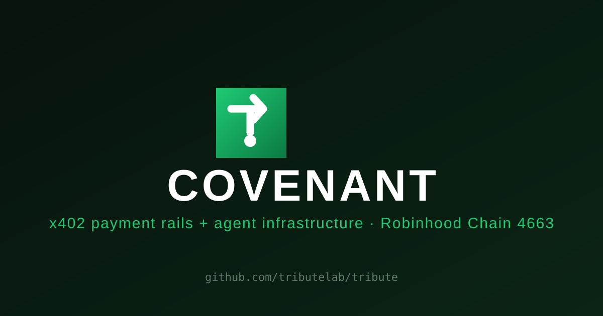

<p align="center">
  
</p>

<h1 align="center">COVENANT</h1>
<p align="center"><strong>Multi-chain x402 payment rails + agent infrastructure</strong></p>

<p align="center">
  <a href="https://github.com/tributelab/covenant/actions/workflows/ci.yml"></a>
  <a href="https://www.npmjs.com/package/@covenantx402/x402-kit"></a>
  <a href="LICENSE"></a>
  
  
</p>

<p align="center"></p>

> Paid agent endpoints in USDC/USDG over x402, with instant on-chain settlement and credentials that never touch a prompt.

COVENANT turns any endpoint into a paid stablecoin route, settles through **x402 — v1 and v2 simultaneously** — across **four chains (Robinhood 4663, Ethereum, Base, Arbitrum)**, and brokers agent credentials through a live vault so models can use secrets without seeing them. Open source, MIT-licensed.

Five pillars, one gateway:

| Layer | What it does | Where |
|---|---|---|
| **Payments** | Any endpoint → paid x402 route. 402 → signed intent → on-chain settlement. Dual-protocol: emits x402 v1 (JSON body) *and* v2 (`Payment-Required` header + `extensions.bazaar` discovery) on every paid response. | `kit/` + `gateway/` |
| **Multi-chain** | One agent, one key, four settlement rails — pay on whichever chain has your liquidity. `GET /chains` returns live readiness (RPC up, gas funded) per chain before you commit to one. | `gateway/chains.js`, `gateway/facilitator.js` |
| **Vault** | Agent credential broker. Secrets referenced as `{{name}}`, AES-256-GCM at rest, scrubbed from every readback. | `gateway/agent-vault.js` |
| **Identity** | Every agent gets a server-generated wallet + a `cvn_...` API key on first use. | `gateway/wallets.js`, `gateway/keys.js` |
| **Reputation** | Every settled payment feeds an explainable 0–100 score, anchored to real tx hashes — not a black box. | `gateway/reputation.js` |

## Why this isn't "just a 402 demo"

- **Four chains, one replay-guard, correctly scoped.** Robinhood Chain (USDG), Ethereum, Base, and Arbitrum (Circle-native USDC) — each chain's own RPC, settlement wallet instance, and EIP-712 domain (`chainId` is part of the domain, so a signature for chain A cannot replay on chain B). The nonce table's primary key is `(chain_id, nonce)`, not just `nonce` — a SQLite schema migration (not a greenfield assumption) that keeps old single-chain history intact while making cross-chain nonce collision structurally impossible.
- **BNB Chain was evaluated and explicitly rejected, not silently skipped.** Its "USDC" is Binance-Peg (bridged, not Circle-issued), 18 decimals instead of 6, no EIP-3009/`DOMAIN_SEPARATOR`. Mixing an 18-decimal asset into 6-decimals-everywhere code is exactly the silent-wrong-amount bug class that shouldn't ship — see the comment in `gateway/chains.js`.
- **Every asset address was verified on-chain before being added**, not copied from a block explorer listing — `eth_getCode` + `symbol()`/`decimals()`/`name()`/`DOMAIN_SEPARATOR()` via `eth_call` against a public RPC.
- **Machine-readable discovery that's actually complete.** `GET /openapi.json` returns a full OpenAPI 3.1 document — every paid route carries `x-payment-info` with *both* the per-call and session protocols, so an agent scanner (e.g. [x402scan](https://www.x402scan.com)) discovers the cheaper session option without a human reading the README first.
- **Dual x402 transport, same route.** The ecosystem moved from v1 (JSON-body challenge) to v2 (`Payment-Required` header + `extensions.bazaar`) in Dec 2025. COVENANT's `x402-v2.js` adapter encodes a spec-compliant v2 header with the official `@x402/core` codec on top of the same route data — old clients and new clients both get a valid 402, no flag-flipping.
- **Settlement is the honest `approve+transferFrom` pattern, not a claimed EIP-3009.** None of the four supported chains' deployments implement `transferWithAuthorization` as COVENANT uses them — verified against on-chain bytecode, documented in the code rather than assumed. See [How settlement works](#how-settlement-works).
- **Sessions aren't a toy feature.** Settle once (0.01 USDG → 100 calls / 1h), then `POST /session/redeem` per call with **no wallet interaction, no signature, no on-chain tx** — a 100x cost reduction for agents that hammer an API, and it's advertised in the OpenAPI doc's `x-payment-info.protocols[1]`, not hidden behind a support thread.
- **Reputation is explainable, not vibes.** `score(address)` = settled-count (log scale, 40pt) + cumulative volume (25pt) + longevity (15pt) + recency (20pt) — every point traceable to a real settlement tx hash via `GET /reputation/:address`.
- **Signed webhooks, not an open POST.** The kit's `settlementWebhook` carries an HMAC-SHA256 `X-Covenant-Signature` header when `settlementWebhookSecret` is set, with constant-time verification and 3-attempt exponential-backoff delivery — a receiver can reject spoofed settlement callbacks instead of trusting whoever finds the URL.
- **Prometheus metrics, not just a JSON dashboard.** `GET /metrics` exposes the same live counters as `/x402/stats` in standard text-exposition format — drop the gateway into existing Grafana/Alertmanager stacks without scraping JSON.

## Repository layout

```
gateway/   Zero-dependency HTTP gateway: RPC proxy, x402 v1+v2, vault, facilitator (settlement), reputation
kit/       TypeScript middleware (@covenantx402/x402-kit) — Express paywall + usage analytics
examples/  Runnable examples: paywalled API, agent client that pays
skill/     Agent skill file (SKILL.md) — teach any agent (Claude/Cursor/Hermes) to use COVENANT
```

## Quick start (gateway)

```bash
cd gateway
npm install            # pulls ethers, better-sqlite3, @x402/core
cp .env.example .env   # set RPC upstream + settlement key
node server.js         # listens on 127.0.0.1:8792
```

Then explore the machine-readable contract: `curl http://127.0.0.1:8792/openapi.json`

### Environment

| Variable | Required | Purpose |
|---|---|---|
| `COVENANT_RPC_UPSTREAM` | yes | JSON-RPC URL for Robinhood Chain (e.g. `https://robinhood-rpc.publicnode.com`). Comma-separate for automatic failover (`ethers.FallbackProvider`, quorum 1) on the settlement path — recommended in production. |
| `COVENANT_RPC_ETHEREUM` / `COVENANT_RPC_BASE` / `COVENANT_RPC_ARBITRUM` | for those chains | Same comma-separated-failover RPC config, one per additional chain. A chain with no RPC configured just reports `configured: false` on `GET /chains` — the other chains keep working. |
| `COVENANT_PORT` | no | Listen port (default `8792`) |
| `COVENANT_SETTLE_KEY` | for settlement | Private key of the facilitator's settlement wallet (the spender agents approve) — same key, reused across all four chains (one wallet, four networks). |
| `COVENANT_X402_PAYTO` | no | Default recipient address for paid routes |
| `COVENANT_VAULT_KEY` | recommended | Pepper for vault encryption at rest. Derived from the RPC URL if unset — set your own in production |
| `COVENANT_VAULT_STORE` / `COVENANT_KEYS_STORE` / `COVENANT_WALLETS_STORE` / `COVENANT_SETTLE_STORE` | no | Storage paths (default under `data/`) |
| `COVENANT_TRUSTED_PROXIES` | no | Comma-separated reverse-proxy IPs trusted to set `X-Forwarded-For` for per-IP rate limiting. Leave empty when reached directly. |

## Multi-chain settlement

COVENANT settles on four chains from one gateway, one agent key, one settlement wallet:

| Chain | Chain ID | Asset | Env var |
|---|---|---|---|
| Robinhood Chain | `4663` | USDG (default/legacy) | `COVENANT_RPC_UPSTREAM` |
| Ethereum | `1` | USDC (Circle) | `COVENANT_RPC_ETHEREUM` |
| Base | `8453` | USDC (Circle) | `COVENANT_RPC_BASE` |
| Arbitrum One | `42161` | USDC (Circle) | `COVENANT_RPC_ARBITRUM` |

```bash
curl https://gateway.covenantx402.com/chains
```
Returns every chain's id, asset address, decimals, and **live readiness** (RPC reachable, settlement wallet funded with native gas) — so an agent can pick a working rail before committing to a payment flow instead of discovering a dead RPC mid-settlement.

Pass `?chain=<id>` on any `GET /x402/api/:slug` call (or `chainId` in the signed intent / settle body) to target a non-default chain. Omit it everywhere and behavior is unchanged from the single-chain era — Robinhood 4663 stays the default. Every chain gets its own EIP-712 domain (`chainId` is part of the signed domain), its own memoized RPC provider + settlement wallet instance, and its own nonce/settlement rows keyed by `(chain_id, ...)` — a signature valid on one chain cannot replay on another.

## How settlement works

None of the four supported chains' stablecoin deployments implement EIP-3009 `transferWithAuthorization` the way COVENANT would need — verified against on-chain bytecode, not assumed. COVENANT settles with **approve + transferFrom** on every chain:

1. Gateway returns `402` describing price, asset, recipient, and the facilitator's spender address for the requested chain (v1 JSON body *and* v2 `Payment-Required` header, both on the same response).
2. Agent approves the spender once on that chain (`token.approve(spender, amount)`), then signs an **EIP-712 `PaymentIntent`**:
   ```
   PaymentIntent { from, to, value, validAfter, validBefore, nonce, resource }
   ```
   Domain: `name "COVENANT"`, `version "1"`, `chainId <target chain>`, `verifyingContract` = that chain's stablecoin address.
3. Agent POSTs `{ intent, signature, chainId }` to `POST /facilitator/settle`.
4. Facilitator verifies signature + balance + allowance + authorization window + nonce replay **on that chain**, executes `transferFrom`, returns the tx hash.

Every settlement is replay-guarded by a persisted `(chain_id, nonce)` pair and auditable by tx hash. Set `resource: "session"` instead to open a 100-call / 1h prepaid session in the same settle call — see [`/x402/premium`'s `x-payment-info.protocols[1]`](#why-this-isnt-just-a-402-demo).

## Gateway endpoints

**Discovery (free, no auth):**

- `GET /openapi.json` — full OpenAPI 3.1 contract, every route's price + both payment protocols
- `GET /.well-known/x402` — x402scan-compatible resource index
- `GET /chains` — supported chains + live readiness (RPC up, settlement wallet funded)
- `GET /metrics` — Prometheus text-exposition metrics
- `GET /x402/apis` — registered paid routes + live hit counts
- `GET /reputation` — leaderboard · `GET /reputation/:address` — score + tx anchors

**Paid (402 until settled):**

- `GET /x402/api/:slug`, `GET /x402/premium` — pay-per-call or session (`?chain=<id>` to target a non-default chain)
- `POST /facilitator/verify` — verify a signed intent without settling
- `POST /facilitator/settle` — settle on-chain (per-call or session, any supported chain)
- `POST /session/redeem` — spend one session call, zero on-chain interaction
- `GET /session/:id` — session status

**Agent identity (key-authed via `Authorization: Bearer cvn_...`):**

- `POST /keys` — mint an agent API key (shown once)
- `POST /vault/entries`, `POST /vault/broker` — store secrets, or run a prompt with secrets injected server-side (**the secret never reaches the agent's context**)
- `POST /wallets/create` — server-generated agent wallet
- `GET /analytics/keys` — per-key usage stats

## Rate limiting

Sliding-window per agent key (authenticated) or per IP (open endpoints), `X-RateLimit-*` + `Retry-After` headers. Defaults: 5 keys/hour/IP on `POST /keys`, 60 settles/min, 120 verifies/min, 300 req/min generic. `X-Forwarded-For` is only trusted from IPs listed in `COVENANT_TRUSTED_PROXIES` — unlisted, it's ignored in favor of the raw socket address, closing the classic rate-limit-bypass-by-header-spoofing hole. Tune in `gateway/server.js` → `RATE_LIMITS`.

## The kit — `@covenantx402/x402-kit`

Self-contained TypeScript x402 paywall middleware for Express, with signed settlement webhooks:

```bash
npm install @covenantx402/x402-kit
```

```ts
import express from 'express'
import { install } from '@covenantx402/x402-kit'

const app = express()
install(app, {
  config: {
    payTo: '0xYourAddress',
    network: 'robinhood',
    facilitatorUrl: 'https://gateway.covenantx402.com',
    routes: { 'GET /premium': { price: '0.01' } },
  },
})
app.get('/premium', (_req, res) => res.json({ data: 'paid content' }))
app.listen(3000)
```

Full usage: [`kit/README.md`](kit/README.md).

## Examples

- `examples/paid-api.js` — spin up a paid endpoint with the gateway
- `examples/pay.js` — agent client: fetch 402 → sign intent → settle → receive resource

## Testing

```bash
cd gateway && npm test     # smoke.js, preflight.js, pay-once.js, pay-onchain.js, gen-load.js
cd kit && npm run build    # tsc -p .
```
CI (`.github/workflows/ci.yml`) runs both on every push/PR to `main`.

## Agent skill

[`skill/SKILL.md`](skill/SKILL.md) is a drop-in Markdown skill file — point Claude/Cursor/Hermes/any skill-aware agent at it and it learns the full payment + vault flow without further prompting.

## Security notes (read before deploying)

- Set `COVENANT_VAULT_KEY` in production; otherwise the vault key derives from the RPC URL.
- `POST /keys` is intentionally open for frictionless onboarding — rate-limit it at your edge if you expose the gateway publicly.
- `COVENANT_SETTLE_KEY` can pull any USDG amount agents have approved to it. Run it hot with a small float; keep the bulk cold.
- The RPC proxy (`POST /`) is a strict method whitelist — no state-changing methods pass through.

## License

MIT
